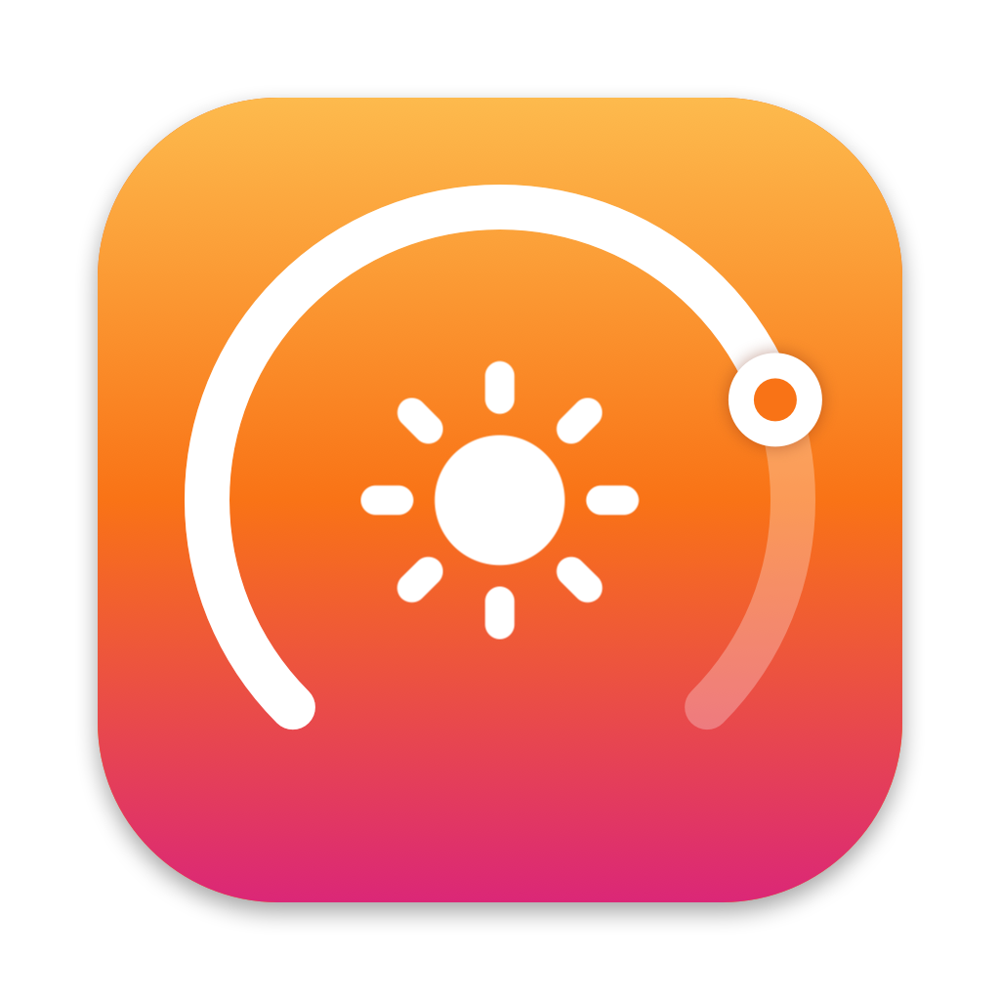
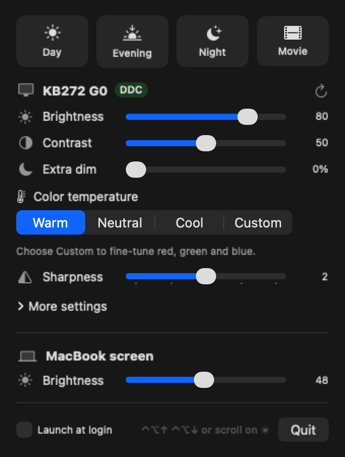

<p align="center">
  
</p>

<h1 align="center">DisplayDial</h1>

<p align="center">
  Change your external monitor's real brightness, contrast and colors from the Mac menu bar.
</p>

<p align="center">
  <a href="https://github.com/yaksh1010/DisplayDial/releases/latest/download/DisplayDial.dmg"><b>⬇️ Download DisplayDial.dmg</b></a>
</p>

<p align="center"></p>

## What it does

Click the ☀︎ in the menu bar and you get:

- **Brightness and contrast** sliders that change the monitor itself (over DDC/CI), not just the picture
- **Extra dim**: goes darker than the monitor's lowest setting, for late nights
- **Color temperature**: Warm, Neutral, Cool or Custom (with red, green and blue fine-tuning)
- **Sharpness**, and under *More settings*: black levels, per-color saturation, and factory reset
- **One-click presets**: Day, Evening, Night, Movie. Right-click one to save your current settings into it.
- **Your MacBook's own screen brightness** in the same place

It only shows the settings your monitor says it supports.

**Shortcuts:** scroll on the ☀︎ icon, or press **⌃⌥↑** / **⌃⌥↓** anywhere, to change brightness.

## Requirements

- An Apple Silicon Mac (M1 or later) for real monitor control. On Intel Macs, or monitors that don't support
  DDC/CI, brightness falls back to dimming the picture.
- macOS 13 Ventura or later
- **DDC/CI turned on** in your monitor's own on-screen menu (it usually is by default)

Tested with an Acer KB272 G0 on a 13" M1 MacBook Pro running macOS 26.2.

## Install

1. [Download DisplayDial.dmg](https://github.com/yaksh1010/DisplayDial/releases/latest/download/DisplayDial.dmg), open it and drag **DisplayDial** into **Applications**.
2. Open DisplayDial. It isn't notarized by Apple, so macOS blocks it the first time:
   - Click **Done** on the warning.
   - Open **System Settings → Privacy & Security**, scroll down and click **Open Anyway** next to DisplayDial.
   - Or run this once in Terminal instead:
     ```bash
     xattr -dr com.apple.quarantine /Applications/DisplayDial.app
     ```
3. Click the ☀︎ in the menu bar. If your monitor shows **Software** instead of **DDC**, turn on DDC/CI in the
   monitor's own on-screen menu, then click ⟳.

No permissions are needed: no accessibility, screen recording or disk access.

## Build from source

Needs Xcode (or the Command Line Tools).

```bash
git clone https://github.com/yaksh1010/DisplayDial.git
cd DisplayDial
./build.sh --install    # build, copy to /Applications, launch
./build.sh --dmg        # make dist/DisplayDial.dmg
```

`DisplayDial --snapshot out.png` draws the popover with live values (used for the image above).

## How it works

| File | What it does |
|---|---|
| [`DDC.swift`](Sources/DDC.swift) | DDC/CI over I²C: read and write settings, read the monitor's capability list |
| [`Displays.swift`](Sources/Displays.swift) | Finds monitors, keeps their values, presets, software dimming, MacBook brightness |
| [`PopoverView.swift`](Sources/PopoverView.swift) | The SwiftUI menu bar popover |
| [`AppDelegate.swift`](Sources/AppDelegate.swift) | Menu bar icon, scroll-to-adjust, ⌃⌥↑/↓ shortcuts |

Talking to monitors on Apple Silicon uses private IOKit calls (`IOAVServiceWriteI2C`), the same ones
[MonitorControl](https://github.com/MonitorControl/MonitorControl) and [m1ddc](https://github.com/waydabber/m1ddc)
use. That's why it can't be on the Mac App Store. Brightness slider drags are coalesced, so the monitor
only gets the latest value instead of a flood of commands.

## License

[MIT](LICENSE)
